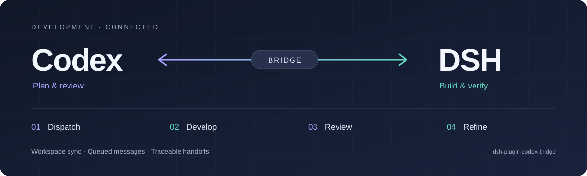

<div align="center">



# dsh-plugin-codex-bridge

**连接 Codex 与 DeepSeek Harness 的开发协作桥梁**

从 Codex 派发任务，让 DSH 独立开发，再将结果交回 Codex 审查。<br>
审查意见回到原开发会话，继续完成修复与验证。

[](https://github.com/heswy/dsh-plugin-codex-bridge/actions/workflows/ci.yml)
[](LICENSE)
[](#兼容性与边界)

**简体中文** · [English](README.en.md)

[快速开始](#快速开始) · [使用示例](#使用示例) · [配置](#配置) · [文档](#文档导航)

</div>

---

## 从任务派发到审查修复

适合用 Codex 负责规划与审查、用 DSH 开发会话负责实施的工作流。项目提供协作通道；任务范围、开发者选择、Git 操作与发布仍由用户授权决定。

| 阶段 | 协作方式 |
|---|---|
| **01 · 派发任务** | Codex 通过 `codex2dsh` 登记工作区、创建会话并投递已授权的任务。 |
| **02 · 独立开发** | DSH 在任务工作区实施与验证；插件把外部登记的工作区同步到桌面侧栏。 |
| **03 · 交回审查** | 开发者完成提交、推送与 PR 后，`dsh2codex` 校验 Git 状态并通知指定的 Codex 对话。 |
| **04 · 原会话修复** | Codex 在已有授权范围内，把审查意见投递回原 DSH 会话，继续修复与验证。 |

## 三个组件，一条协作链路

DSH 的会话遵循**单写者**约束：桌面持有会话写锁时，另一个宿主的写入会被拒绝。本项目通过持锁宿主代投，让外部驱动与正在使用的桌面会话协作。

| 组件 | 提供的能力 | 安装位置 |
|---|---|---|
| **DSH 插件** | 工作区定期同步、手动刷新、文件投递箱与回执。默认消息排队，不打断当前轮次。 | DSH 插件管理器 |
| **`codex2dsh`** | 创建工作区与开发会话，向原会话投递任务或审查意见。 | Codex 的 skill 目录 |
| **`dsh2codex`** | 校验已推送的 Git 状态，把验证摘要与 PR 信息交回主管对话。通知账本用于去重。 | DSH 的 skill 目录 |

插件与两个 skill 可以独立安装。插件只使用 Node.js 内置模块，**零 npm 运行时依赖**。

## 快速开始

### 1. 准备环境

使用 DSH `0.2.0-rc.2` 与 Node.js 20+。完整双向协作还需要 Python 3.10+、Git，以及支持 `queue --thread --message` 的 Codex CLI。详见[兼容性与边界](#兼容性与边界)。

### 2. 安装 DSH 插件

在 **设置 → 插件 → 添加插件** 中输入仓库地址：

```text
https://github.com/heswy/dsh-plugin-codex-bridge
```

也可使用本地仓库的绝对路径。安装后确认插件已启用，并保持 DSH 桌面运行。

### 3. 安装双向 skill

获取仓库，并分别复制到两个应用的 skill 目录：

```sh
git clone https://github.com/heswy/dsh-plugin-codex-bridge.git
cd dsh-plugin-codex-bridge

mkdir -p ~/.dsh/skills ~/.codex/skills
cp -R skills/dsh2codex ~/.dsh/skills/
cp -R codex-skills/codex2dsh ~/.codex/skills/
```

以上使用默认目录；自定义数据或 skill 目录时请调整路径。仅使用单向协作时，可跳过另一方向的 skill。

### 4. 确认通道就绪

- 插件列表中的 `dsh-plugin-codex-bridge` 处于启用状态。
- 侧栏底部出现工作区刷新按钮；点击可立即同步。
- 运行以下命令查看宿主发布的会话索引与交回 CLI 能力：

```sh
node tools/send.mjs --list
python3 skills/dsh2codex/scripts/notify.py --probe
```

会话索引默认约每 10 秒更新。确认生成时间、目标会话 ID 与工作目录；索引存在本身不能证明当前可投递。`--probe` 只检查 CLI 能力，不发送通知。

## 使用示例

### 向原 DSH 会话投递审查意见

先使用 `--list` 获取完整会话 ID，替换下例中的 `<sessionId>`：

```sh
node tools/send.mjs \
  --session '<sessionId>' \
  --text '请在原任务分支修复 PR 审查意见，并补充相关验证。' \
  --mode queue \
  --from codex \
  --id review-followup-001
```

默认 `queue` 等当前轮次结束；`steer` 默认被拒绝。读取回执时，**`ok: true` 且 `accepted: true` 才确认会话接受，接受不代表任务完成**。若 `queuedBehindRunningTurn: true`，消息正在等待当前轮次结束。

发送端退出码：`0` 表示投递调用成功，`1` 表示被拒或失败，`2` 表示用法错误或回执超时。请结合回执中的 `accepted` 判断接受状态。超时后检查原请求与回执，避免盲目重发或更换请求 ID。

### 将开发结果交回 Codex

准备验证摘要和明确的主管对话 UUID，先预演核对通知内容：

```sh
python3 skills/dsh2codex/scripts/notify.py \
  --thread '<supervisor-thread-uuid>' \
  --repo '/absolute/path/to/task-worktree' \
  --branch 'task-branch' \
  --pr-url 'https://github.com/owner/repo/pull/123' \
  --summary-file '/absolute/path/to/verification-summary.md' \
  --dry-run
```

确认后移除 `--dry-run` 发送。脚本检查当前分支、工作区是否干净、`origin` 推送仓库与 PR URL 是否匹配，以及完整 HEAD 是否已在远端任务分支；**PR 实际 head 与审查结论由主管独立核对**。

通知状态为 `queued`、`already-queued`、`blocked` 或 `unknown`。确定性事件 ID 与本地账本阻止自动重复发送；结果不确定时停止并保留记录。这是保守的去重机制，不保证任意故障条件下的端到端“恰好一次”交付。

## 配置

在 **profile 自己的 `cordis.patch.yml`** 中覆盖设置，它在 bundle 配置之后生效：

```yaml
- id: workspace-sync
  config:
    intervalMs: 15000
    inbox:
      allowSteer: false
```

默认工作区同步周期为 5 秒，投递箱取件周期为 1 秒。`DSH_HOME` 未设置时使用 `~/.dsh`。

<details>
<summary><strong>完整配置参考</strong></summary>

| 字段 | 默认值 | 说明 |
|---|---|---|
| `routePath` | `/api/workspace-sync` | 宿主 API 路由，必须以 `/api/` 开头；客户端按钮使用默认路由。 |
| `registryFile` | `<DSH_HOME>/storages/workspace.json` | 共享工作区注册文件。 |
| `stateFile` | `<DSH_HOME>/workspace-sync/state.json` | 持久化删除记忆。 |
| `autoSync` | `true` | 定时同步工作区。 |
| `intervalMs` | `5000` | 同步周期，1000–600000 毫秒。 |
| `includeUngroupedSessions` | `false` | 从会话目录推断工作区；默认关闭，避免恢复已删除的工作区。 |
| `attachSessions` | `true` | 把 cwd 落在某工作区里的会话记到该工作区名下（含已有成员的，幂等；注册表自己会复核 cwd） |
| `clientRefresh` | `true` | 点击刷新后是否重载视图（会话目录按连接拉取，外部新会话不会推送）。`true` 每次都重载、`'on-change'` 只在对账确有变化时、`false` 关闭 |
| `excludeDshHome` | `true` | 排除 DSH 数据目录内的候选工作区。 |
| `maxAddsPerPass` | `20` | 每轮新增上限，1–200。 |
| `verbose` | `false` | 每轮记录日志。 |
| `inbox.enabled` | `true` | 启用投递箱。 |
| `inbox.dir` | `<DSH_HOME>/inbox` | 请求、回执与会话索引目录。 |
| `inbox.intervalMs` | `1000` | 取件周期，200–600000 毫秒。 |
| `inbox.allowSteer` | `false` | 允许向当前轮次插话；需显式开启。 |
| `inbox.maxTextBytes` | `200000` | 正文 UTF-8 字节上限，1–10000000。 |
| `inbox.indexIntervalMs` | `10000` | 会话索引更新周期，1000–600000 毫秒。 |
| `inbox.deliveryTimeoutMs` | `30000` | 单次投递超时，1000–600000 毫秒。 |

</details>

<details>
<summary><strong>宿主 API 与开发模式挂载</strong></summary>

| 请求 | 用途 |
|---|---|
| `GET /api/workspace-sync` | 配置、最近一次同步结果与能力自检状态。 |
| `POST /api/workspace-sync?action=sync` | 立即同步。 |
| `GET /api/workspace-sync?action=doctor` | 运行能力自检。 |

开发模式可在 profile 的 `cordis.patch.yml` 中手工挂载：

```yaml
- insert:
    - id: workspace-sync
      name: '/absolute/path/to/dsh-plugin-codex-bridge/lib/index.js'
```

手工挂载与插件管理器安装应二选一，避免重复加载。

</details>

## 兼容性与边界

| 组件 | 要求与验证范围 |
|---|---|
| DSH 插件 | 面向 DSH `0.2.0-rc.2`；Node.js 20+；macOS 有实测记录，插件 CI 配置覆盖 Linux 与 macOS。 |
| `dsh2codex` | Python **3.9+**、Git、支持 `queue --thread --message` 的 Codex CLI；用 `--probe` 检查。 |
| `codex2dsh` | Python 3.10+ 与 DSH CLI/宿主；创建任务脚本使用 POSIX `fcntl`。 |
| 平台与托管 | Windows 未验证；交回仓库与 PR URL 校验支持 `github.com`。 |

- **同步机制：** 使用轮询与手动刷新。插件加载后，同步外部工作区无需重启桌面；修改宿主代码需要重启或重新安装生效。
- **工作区生命周期：** 仅补充本地缺失的登记。默认关闭会话目录推断，并持久化删除记忆；共享文件中的显式登记仍可覆盖删除记忆。
- **共享写入：** 多宿主同时写 `workspace.json` 仍可能后写覆盖。插件定期对账，不提供跨进程事务。
- **会话所有权：** 写入由持锁宿主执行。遇到 `session/writer-held` 或不确定结果时，应检查所有权与回执。
- **兼容性检查：** 插件依赖 DSH 内部服务契约，运行时 `doctor` 检查并报告漂移；没有版本闸门不代表兼容所有 DSH 版本。
- **授权范围：** 插件不自动提交、推送、创建 PR、合并或发布。两个 skill 仅在用户授权的任务范围内使用。

## 文档导航

以下深入文档目前以中文为主；本 README 提供完整英文版。

| 文档 | 内容 |
|---|---|
| [Codex 接入说明](docs/FOR-CODEX.md) | 会话发现、消息投递与协作入口。 |
| [投递箱协议](docs/codex-handoff.md) | 请求字段、结果文件、回执语义与处理规则。 |
| [内部机制](docs/internals.md) | 工作区对账、删除记忆、会话锁与实测依据。 |
| [更新日志](CHANGELOG.md) | 版本记录、修复项与已知边界。 |
| [`codex2dsh`](codex-skills/codex2dsh/README.md) | Codex 侧任务派发与审查反馈。 |
| [`dsh2codex`](skills/dsh2codex/README.md) | DSH 侧交回通知与状态处理。 |

## 开发与验证

在仓库根目录运行离线测试，无需真实 DSH 或 Codex 服务：

```sh
node tests/harness.mjs
node tests/inbox.mjs
node tests/relay-e2e.mjs
python3 skills/dsh2codex/tests/test_notify.py
python3 codex-skills/codex2dsh/scripts/test_new_task.py
```

只读预演本机候选工作区：`node tests/dry-run.mjs`。CI 定义见 [ci.yml](.github/workflows/ci.yml)。

贡献请保持三个原则：**目标显式、重复操作可控、结果可审计**。仓库内的 skill 是源文件，安装目录中的是副本；更新时需考虑同步。欢迎提交 [Issue](https://github.com/heswy/dsh-plugin-codex-bridge/issues) 或 PR。

---

<div align="center">

[MIT License](LICENSE) · **heswy**<br>
插件与两个 skill 分别附带同文 MIT 许可证。

[English](README.en.md) · [返回顶部](#dsh-plugin-codex-bridge)

</div>
